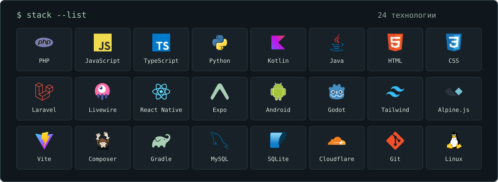

  

[Проекты](#проекты) | [Стек](#стек) | [Активность](#активность) | [Резюме](#резюме) | [Портфолио](https://semgaa.github.io/)

Пишу сайты и веб-приложения на Laravel. Мобильные приложения делаю на React Native и Expo. Ещё пишу плагины и моды для Minecraft и делаю игры на Godot.

Ищу удалённую работу junior-разработчиком или стажировку.

[Telegram](https://t.me/HelpHelsing) | [Почта](mailto:pazukha.sema@mail.ru)

## Стек

Стек по направлениям

- Веб: PHP, Laravel, Livewire, HTML, CSS, JavaScript, Tailwind CSS, Alpine.js, Vite.
- Мобильные приложения: TypeScript, React Native, Expo, Android.
- Игры: Java, Forge, Gradle, Godot.
- Данные и инструменты: MySQL, SQLite, Cloudflare Workers, Composer, Git, Linux.

## Проекты

<b>EDO Portal</b> (веб)

Сервис для работы с документами. Можно создать документ, отправить на согласование, вернуть на доработку или убрать в архив. Есть доступ по ролям и отделам, история действий и поиск.

PHP, Laravel, Livewire, SQL.

[Код и запуск](https://github.com/SemGAA/edo-portal#readme)

<b>Cinema Notes</b> (Android)

Приложение для Android с поиском фильмов, сериалов и аниме, комнатами просмотра, друзьями и заметками. Код приложения и Laravel API лежит в одном репозитории.

TypeScript, React Native, Expo, Laravel API.

[Страница проекта](https://semgaa.github.io/Program_kinp/) | [Скачать APK](https://github.com/SemGAA/Program_kinp/releases) | [Код](https://github.com/SemGAA/Program_kinp)

<b>Minecraft Meteor Mod</b> (Minecraft 1.21)

Добавляет падение метеорита в Minecraft 1.21. Событие обрабатывается на сервере, эффекты отображаются на клиенте.

Java 21, Forge, Gradle.

[Скачать мод](https://github.com/SemGAA/minecraft-meteor-mod/releases) | [Код](https://github.com/SemGAA/minecraft-meteor-mod)

## Активность

Вклады по месяцам

Снимок календаря на 22.10.2026. Свежие данные можно посмотреть в [календаре GitHub](https://github.com/SemGAA#js-contribution-activity-description).

| Месяц | Вклады |
| --- | ---: |
| 2025-10 | 13 |
| 2025-11 | 5 |
| 2025-12 | 3 |
| 2026-01 | 6 |
| 2026-02 | 24 |
| 2026-04 | 69 |
| 2026-06 | 4 |
| 2026-07 | 5 |
| 2026-08 | 8 |
| 2026-10 | 6 |

## Резюме

[PHP / Laravel](./RESUME_PHP_LARAVEL.md) | [Мобильная разработка](./RESUME_MOBILE.md)

Образование

Усть-Катав, Россия.

- **УКИТТ (2022-2026)**, специальность «Информационные системы».
- **ЮУрГУ**, учусь по направлению «Информационные системы и технологии».

