  

  <a href="https://semgaa.github.io/"><b>Портфолио ↗</b></a>
  &nbsp; / &nbsp;
  <a href="https://t.me/HelpHelsing">Telegram</a>
  &nbsp; / &nbsp;
  <a href="mailto:pazukha.sema@mail.ru">Почта</a>

Пишу веб-приложения на **Laravel** и мобильные приложения на **React Native / Expo**. Делаю плагины и моды для **Minecraft**, разрабатываю игры на **Godot**.

Ищу удалённую работу или стажировку в веб- и мобильной разработке.

## Проекты

### [EDO Portal](https://github.com/SemGAA/edo-portal)
Электронный документооборот: создание документов, согласование, возврат на доработку и архив. Доступ по ролям и отделам, история действий, поиск и фильтры.

`PHP` `Laravel` `Livewire` `SQL`

[Код и запуск →](https://github.com/SemGAA/edo-portal#readme)

### [Cinema Notes](https://github.com/SemGAA/Program_kinp)
Android-приложение для фильмов, сериалов и аниме: поиск, комнаты просмотра, друзья и заметки. В репозитории — приложение и серверная часть, в релизах — APK.

`TypeScript` `React Native` `Expo` `Laravel API`

[Страница проекта →](https://semgaa.github.io/Program_kinp/) · [Скачать APK →](https://github.com/SemGAA/Program_kinp/releases) · [Код →](https://github.com/SemGAA/Program_kinp)

### [Minecraft Meteor Mod](https://github.com/SemGAA/minecraft-meteor-mod)
Мод для Minecraft 1.21: падение метеорита, серверная логика события и визуальные эффекты на клиенте.

`Java 21` `Forge` `Gradle`

[Скачать мод →](https://github.com/SemGAA/minecraft-meteor-mod/releases) · [Код →](https://github.com/SemGAA/minecraft-meteor-mod)

---

**Резюме:** [PHP / Laravel](./RESUME_PHP_LARAVEL.md) · [Мобильная разработка](./RESUME_MOBILE.md)

Образование и немного обо мне

Усть-Катав, Россия.

- **УКИТТ, 2022–2026** — «Информационные системы».
- **ЮУрГУ** — учусь по направлению «Информационные системы и технологии».

